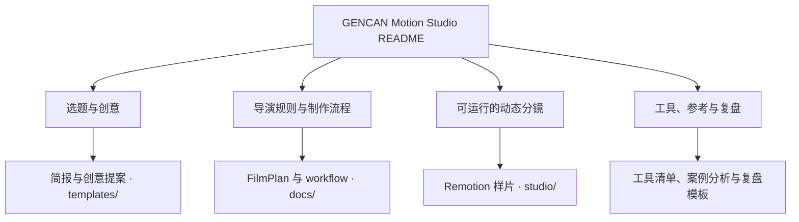
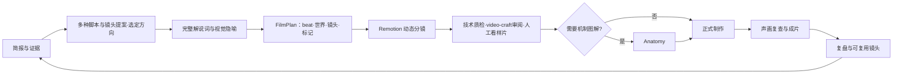

# GENCAN Motion Studio

一套可重复执行、可审阅、可改进的知识讲解视频制作流程。每期视频从同一份选题简报开始，经过有出处的调研、解说词、分镜、图解、时间轴和质检，最后留下可复用的经验。

本仓库保存**导演流程、模板和一段可运行的 15 秒动态分镜**。样片尚无配音，不是正式成片；第三方程序不复制进仓库，选入的素材须有明确授权和来源记录。

## 仓库导览

README 是入口；先按主题选题和提案，再读导演规则，最后可运行 `studio/` 查看 FilmPlan 如何驱动动态分镜。

## 导演计划怎样驱动制作

| 角色或工具 | 负责什么 | 交给下一步什么 |
| --- | --- | --- |
| Codex 编剧／导演 | 从调研提出不同的脚本与镜头方向，选定后确定 beat、共享世界、对象状态、镜头路径和声音标记 | 创意提案、选择记录、可验证的 `FilmPlan` |
| [video-craft](https://github.com/Orkas-AI/Orkas-VideoStudio/tree/main/packages/skills/video-craft)（审阅层） | 检查叙事、焦点、运动目的、字幕与声音的审美问题 | 可定位到 beat 或镜头的修改建议 |
| Anatomy（按需） | 把需要拆解的机制设计成可复现图解 | SVG 或逐帧图像与参数说明 |
| [Remotion](https://www.remotion.dev/) | 用同一计划制作动态分镜、预览和正式合成 | Studio 预览、可重复渲染的视频 |
| 自有辅助流程（按需） | 调研、配音、字幕和质检分别选择授权适合项目的工具 | 可回填进 `FilmPlan` 的素材与标记 |

请在[工具清单](docs/tools.md)记录自己实际使用的版本与安装位置。

## 开始一条新视频

1. 复制 [`templates/episode-brief.md`](templates/episode-brief.md) 到新视频的工作目录，确定主题、受众、时长、语言、交付形式与事实来源。
2. 用 [`templates/concept-proposal.md`](templates/concept-proposal.md) 比较创意方向并记录选择；用户已指定方向时直接记录，再写完整解说词。
3. 按 [`docs/film-plan.md`](docs/film-plan.md) 建立可验证的导演计划，再按 [`docs/workflow.md`](docs/workflow.md) 先做 10–15 秒动态分镜。
4. 每次制作都记录实际使用的工具版本、来源、难点、质检结论与改进建议。可用 [`templates/episode-review.md`](templates/episode-review.md)。
5. 想改流程时阅读 [`CONTRIBUTING.md`](CONTRIBUTING.md)，说明问题、证据和可验证的改法。样片可在 `studio/` 运行：`npm install` 后执行 `npm run dev`，打开 `GENCAN-ContextThread`。

## 仓库边界

- 可以提交流程文档、模板、图解与镜头的**自有源码**、来源清单和经过确认的质检记录。
- 大体积视频、配音、渲染帧和缓存默认留在本地；需要共享时另用发行版、对象存储或适合大文件的机制，并在记录里写明位置。
- 不提交 API 密钥、登录信息、未经授权的素材、第三方 skill 的整份拷贝或人物肖像原件。

详细步骤见[制作流程](docs/workflow.md)，OpenMontage 的借鉴范围见[架构借鉴记录](docs/openmontage-adoption.md)，两段参考作品的实测与架构校准见[参考分析](docs/reference-analysis.md)，安装与集成规则见[工具清单](docs/tools.md)。
