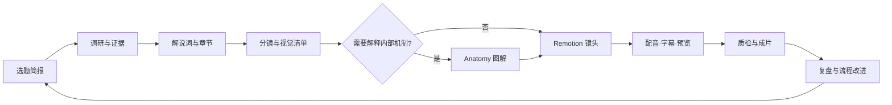

# GENCAN Motion Studio

一套可重复执行、可审阅、可改进的知识讲解视频制作流程。每期视频从同一份选题简报开始，经过有出处的调研、解说词、分镜、图解、时间轴和质检，最后留下可复用的经验。

本仓库保存**流程与模板**，不是示范视频，也不复制三个工具的代码或素材。按需安装和更新工具本身。

## 三个工具怎样配合

| 工具 | 负责什么 | 交给下一步什么 |
| --- | --- | --- |
| Anything to Explainer Production | 统筹调研、解说词、分镜、配音、字幕时间轴和质量检查；提供讲解片的风格与制作规范 | `research.md`、`narration.txt`、`storyboard.md`、时间轴与 QC 记录 |
| Anatomy | 把抽象机制设计成有真实部件和动作逻辑的精细图解；仅在机制需要拆解时使用 | 可重建的图解源码、SVG 或逐帧图像、图解说明 |
| [Remotion](https://www.remotion.dev/) | 把镜头、图解、配音、字幕和覆盖层编排为可预览、可渲染的视频 | Studio 预览、最终视频及渲染配置 |

请在[工具清单](docs/tools.md)记录自己实际使用的版本与安装位置。

## 开始一条新视频

1. 复制 [`templates/episode-brief.md`](templates/episode-brief.md) 到新视频的工作目录，确定主题、受众、时长、语言、交付形式与事实来源。
2. 按 [`docs/workflow.md`](docs/workflow.md) 的关卡逐步制作；文案、配音和前 30 秒预览各有一次明确的审阅点。
3. 每次制作都记录实际使用的工具版本、来源、难点、质检结论与改进建议。可用 [`templates/episode-review.md`](templates/episode-review.md)。
4. 想改流程时阅读 [`CONTRIBUTING.md`](CONTRIBUTING.md)，说明问题、证据和可验证的改法。

## 仓库边界

- 可以提交流程文档、模板、图解与镜头的**自有源码**、来源清单和经过确认的质检记录。
- 大体积视频、配音、渲染帧和缓存默认留在本地；需要共享时另用发行版、对象存储或适合大文件的机制，并在记录里写明位置。
- 不提交 API 密钥、登录信息、未经授权的素材、第三方 skill 的整份拷贝或人物肖像原件。

详细步骤见[制作流程](docs/workflow.md)，安装与集成规则见[工具清单](docs/tools.md)。
